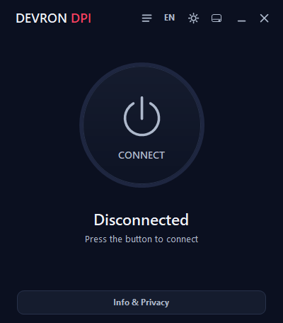

# DevronDPI

**Reach blocked sites in one click. No setup, no VPN, no ping loss.**

🇹🇷 [Türkçe](README.md) &nbsp;|&nbsp; 🇬🇧 **English**

**[⬇ Download DevronDPI.exe](../../releases/latest)** · Double-click it, press **CONNECT**. No installation.

A DPI (deep packet inspection) bypass tool for Windows x64. It lets you reach Discord, Roblox and other sites your internet provider restricts with packet inspection. It works system-wide, in every app including browsers, Discord and games.

## ✨ Why DevronDPI?

- 🎯 **One click, the rest is automatic.** No settings menu, no profile picking, no command line. Press CONNECT; the app tests your network, finds the method that works and **remembers it per network** (home Wi-Fi, phone hotspot…). Later connections are faster.
- 🧠 **It doesn't give up easily.** If the built-in methods fail, it tries others on its own and skips DNS servers that don't answer.
- ⚡ **Not a VPN, no slowdown.** Your traffic is not routed through another server, it goes straight to its destination. It does not affect your ping or speed, so it suits games and Discord voice.
- ✅ **When it says "Connected", it is.** The green state only lights up after a real secure connection to the sites that look blocked on this network (Discord, Roblox, YouTube, Instagram and so on) succeeded.
- 🩺 **If it can't, it tells you why.** No internet, DNS blocked, IP blocked or DPI? It explains in plain words.

### Also

- 🎧 **Discord voice support:** helps get past the blocked first voice packet that is a common reason for being stuck on "RTC Connecting". It cannot help if the voice server's IP address itself is blocked.
- 🔄 **Recovers after network changes:** re-checks the connection when Wi-Fi changes or the PC wakes from sleep.
- 📦 **Single file, no installation:** a portable `DevronDPI.exe`; run it from any folder or a USB drive.
- 🕶️ **Your privacy stays yours:** nothing is collected or stored on the developer side; there is no telemetry.
- 🪶 **Lightweight:** downloads, video and game traffic never reach the app.
- 🌍 **Comfortable to use:** run at startup, optional auto-connect, background mode, hotkey, Turkish and English interface, light/dark theme.

> **Honest note:** DPI bypass defeats packet-inspection (DPI) and DNS-based blocking. A site blocked at the **IP address** level cannot be opened by any DPI tool; the app notices and tells you, and a real VPN is needed. Also, with DNS redirection on, DNS queries (the names of the sites you visit) are sent unencrypted to Yandex, OpenDNS, AdGuard or Quad9 DNS (see [Privacy](#privacy)).

---

## Download and use

1. Double-click `DevronDPI.exe`.
2. Press the big **CONNECT** button. Windows asks for administrator permission the first time (UAC); choose **Yes**.

That's all. The app first checks which sites do not open on this network, then tries methods one by one, verifies each with a real connection and stays on the first one that works. It remembers the working method per network.

Everything it needs is inside `DevronDPI.exe`. Settings live in `%AppData%\DevronDPI\devron.conf`; no other file is created next to the exe.

### Main screen
- **Big button**: connect / disconnect (pressing it while connecting cancels).
- **Automatic analysis**: you don't pick a method by hand. The app tries the method that last worked on this network first, then the standard, alternative, light, fallback DNS (OpenDNS, AdGuard, Quad9) and global methods in order; if none works it moves on to different split points. It stops without waiting if there is no internet or the block is at the IP level.
- **Connection diagnosis**: if it can't connect, the app explains the problem in plain words (*No internet*, *DNS unreachable*, *IP-level block*, *DPI block not bypassed* and so on). Run it any time from the notification-area menu's **Diagnose connection**.
- **Notifications**: a Windows notification appears if the connection drops or is re-established while the window is out of view.
- **Top bar**: Logs, language, light/dark theme, run in background, minimize and close.
- **Logs**: a line-by-line connection history. Filter by *All / Warnings / Errors*, show technical lines with **Details**, copy to the clipboard or save as `.txt`.
- **Notification-area icon**: left click restores the window. Right click opens a menu with connect/disconnect, **run at startup**, **auto-connect at startup** (off by default), run in background, hotkey, diagnose connection, check for updates, and exit.
- **What does "Connected" mean?** That the test sites that look blocked on this network could be reached. It does not guarantee every site will open.

The **X** button closes the app entirely (and disconnects). To keep it running in the background, turn on **run in background** in the top bar; then X and — hide the window to the notification area next to the clock. Click the icon to bring it back; right-click it and choose **Exit** to close it fully.

### Administrator permission
Packet capture needs administrator rights. The window opens with normal rights and only the packet engine runs as administrator, so screenshot tools and hotkeys keep working normally. When the window closes, the engine stops too.

With **Run at startup** on, Windows does not ask for administrator permission at logon or when you press **CONNECT**; you approve it once, when you turn the option on (it may ask once more on the first connect after you update the app to a new version). This option puts a copy of the exe in `C:\Program Files\DevronDPI\`, a folder only administrators can change, and removes it when turned off. The app does not auto-connect at startup by default; turn on **Auto-connect at startup** if you want that. If you move `DevronDPI.exe` to another folder afterwards, turn this option off and back on once.

---

## Privacy

- DevronDPI never stores, collects or shares any of your data on the developer side; there is no telemetry. Settings and logs (`devron.conf`, `devron.log`, `devron-engine.log`) stay only in `%AppData%\DevronDPI` on your own computer.
- During connection tests, only a secure connection is attempted with the test sites; none of your data is sent and no content is downloaded. The sites see your IP address, as in any normal connection.
- Only two things reach official servers, as the internet requires, and they are processed there:
  - **DNS queries** (unencrypted): checked and logged by the chosen DNS server (Yandex, OpenDNS, AdGuard or Quad9).
  - **Update check**: processed by GitHub's servers.

  Those services' own privacy policies apply.
- DNS redirection cannot currently be turned off from the UI. The only profile that skips it is Global, and it is tried last in automatic analysis.

## Good to know

- **DNS redirection:** queries go unencrypted to the chosen DNS server. It also covers your router's own DNS, so internal names on company or school networks may stop resolving. Encrypted DNS (DoH/DoT) is unaffected.
- **QUIC block:** all outgoing UDP 443 traffic is blocked so browsers and Discord use TCP. Some VPNs that use UDP 443 may be affected.
- **If the analysis can't verify a method:** it does not show a green "Connected"; it reports why and logs it.
- **Updates:** every time it starts the app checks GitHub for a new version and asks if there is one. **Yes** downloads and installs it automatically, **No** changes nothing. A downloaded file is only accepted if it comes from GitHub and its SHA-256 matches. See [CHANGELOG.md](CHANGELOG.md) for what changed.
- **Digital signature and antivirus:** the exe is not currently digitally signed, so Windows may show an "Unknown publisher" warning and SmartScreen may warn. Some antivirus programs may give a false alarm such as `RiskTool.WinDivert` because of the packet-capture driver (WinDivert); it is not malware. You can add `DevronDPI.exe` to the exceptions list. If in doubt, compare the file's SHA-256 hash with the value on the release page.

## FAQ

**Why does it ask for administrator permission (UAC)?**
Capturing network packets needs administrator rights on Windows. Only the packet engine runs as administrator; the window opens with normal rights (see [Administrator permission](#administrator-permission)).

**Windows shows an "Unknown publisher" or SmartScreen warning. Is it safe?**
The exe is not digitally signed at the moment, which is why Windows warns. Being unsigned does not mean it is harmful, but download it only from the [releases](../../releases) of this repository and compare its SHA-256 with the value on the release page.

**My antivirus warned me or deleted the file.**
Some antivirus programs may give a false alarm such as `RiskTool` because of the packet-capture driver (WinDivert). It is not malware. You can add `DevronDPI.exe` to the antivirus exceptions.

**It says "Connected" but a site does not open.**
"Connected" means the test sites that look blocked on this network could be reached; it does not guarantee every site will open. If a site is blocked at the IP address level, no DPI tool can open it. Run **Diagnose connection** from the notification-area icon menu; it tells you the cause. Also look at the **Logs** screen.

**Discord voice is stuck on "RTC Connecting".**
DevronDPI can help in this case, but it cannot if the voice server's IP address itself is blocked. Make sure it is connected and that the Logs show no errors.

**My browser uses encrypted DNS (DoH). Is that a problem?**
Encrypted DNS (DoH/DoT) is not affected by the DNS redirection; if your browser uses its own encrypted DNS, it keeps using it.

**What happens when I change Wi-Fi or the PC wakes from sleep?**
The app re-checks the connection and shows a notification if it drops.

**How do I uninstall it?**
First turn off **Run at startup** in the notification-area menu (it removes the tasks and the copy in `Program Files`), then delete `DevronDPI.exe`. If you wish, also delete `%AppData%\DevronDPI` (settings and logs) and `C:\ProgramData\DevronDPI` (the extracted driver files).

**Is my data collected?**
No. See [Privacy](#privacy).

---

## Reporting problems

If you found a bug or have a suggestion, open a new entry on the [Issues](../../issues) page. Please include:
- The DevronDPI version and your Windows version (both are on the first line of the Logs screen).
- What you did and what happened; a screenshot if possible.
- The logs copied with the **Copy logs** button on the **Logs** screen. The log files are in `%AppData%\DevronDPI` (`devron.log`, and `devron-engine.log` for engine errors).

Logs may contain the names of sites used in connection tests; review them before sharing.

---

## License

DevronDPI is closed-source freeware, distributed under the terms of the [License](LICENSE). © 2026 RRaynorr

WinDivert is licensed under LGPLv3. See [THIRD-PARTY-NOTICES.md](THIRD-PARTY-NOTICES.md) for the full list of third-party components.
