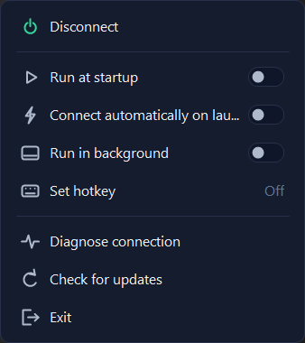

# DevronDPI

**One-click DPI bypass for Windows.** Reach websites, apps, online games and voice platforms restricted by your ISP's deep packet inspection (DPI) — no VPN, no speed or ping loss.

🇹🇷 [Türkçe](README.md) &nbsp;|&nbsp; 🇬🇧 **English**

 

**[⬇ Download the latest release](../../releases/latest)** · Nothing to install. Run `DevronDPI.exe` and press **CONNECT**.

## What it does

- **Zero config.** Tests your network, finds a method that works and saves it per network (home Wi-Fi, phone hotspot…). Later connects are faster.
- **Not a VPN.** Traffic isn't routed through anyone's server, so ping and speed stay the same.
- **"Connected" means connected.** It only turns green after verifying a working encrypted connection with blocked test sites.
- **Tells you what's wrong.** No internet, DNS, an IP block or DPI? If it can't connect, it shows the cause — and you can check any individual site too.
- **Encrypted DNS (DoH) & Anycast bridge.** When well-known provider IPs like `1.1.1.1` or `9.9.9.9` are directly blocked, traffic is routed to a certificate-verified alternative Anycast IP of the same provider.
- **Discord voice.** Helps when you're stuck on "RTC Connecting".
- **Handles network changes.** Waits for internet access when you switch Wi-Fi or wake the PC from sleep, then re-checks the connection automatically.
- **Exempts public & academic domains.** Passes government and university domains worldwide (`.gov`, `.edu`, `.gov.tr`, `.edu.tr`, `.gov.uk`, `.ac.uk`, `.gouv.fr`, `.gob.es`, etc.) through without splitting packets.
- **Portable, no telemetry.** A single exe; settings live in `%AppData%\DevronDPI`.

Also: run at startup, auto-connect on launch, background mode, global hotkey, Turkish/English UI, light/dark themes. Works system-wide on Windows x64.

## Screenshots

| Connected | Logs |
|:---:|:---:|
|  |  |
| **Notification area menu** | **Light theme** |
|  |  |

## Usage

1. Run `DevronDPI.exe`.
2. Press **CONNECT**. Windows asks for admin rights (UAC) the first time; click **Yes**.

The analysis takes a few seconds. Press the button again while it's connecting to cancel.

<b>Window, notification area and logs</b>

- **X** quits the app and disconnects. Turn on **Run in background** in the top bar and X and minimize will hide the window to the notification area instead.
- If the connection drops or comes back while the window is hidden, you get a Windows notification.
- **Notification area icon:** left-click opens the window. The right-click menu has connect/disconnect, **Run at startup**, **Connect automatically on launch** (off by default), hotkey, **Diagnose connection** (general check or a specific address), update check and **Exit**.
- **Logs:** shows the connection history. Switch between *All / Warnings / Errors / Details* (**Details** includes technical lines), and use **Copy logs** to grab the diagnostic summary and engine logs in one click or save them as `.txt`.

<b>Admin rights and "Run at startup"</b>

Capturing packets with WinDivert requires admin rights. The window runs unelevated; only the packet engine runs elevated, in a separate process, so screenshot tools and hotkeys work normally. The engine stops when the window closes.

When you turn on **Run at startup**, you approve UAC once. After that you won't be prompted at logon or when you press **CONNECT** (except possibly once on the first connect after an update). The option copies the exe to `C:\Program Files\DevronDPI\`, which only administrators can modify, and creates a scheduled task. Turning it off removes both. If you move the exe to another folder, toggle the option off and on once.

## Good to know

- **General IP blocks can't be bypassed.** If a site is directly blocked by IP (aside from supported Anycast providers), no DPI tool can open it; you need a VPN. DevronDPI detects this and tells you.
- **"Connected" doesn't guarantee every site.** It means the test sites are reachable.
- **Plain DNS isn't encrypted.** System DNS queries go unencrypted to the selected DNS server. Your browser's own DoH stays untouched — and keeps working on blocked networks thanks to the Anycast bridge.
- **On company or school networks,** DNS redirection may stop internal hostnames from resolving.
- **The QUIC block** may affect VPNs that use UDP 443.
- DNS redirection can't be turned off from the UI. Global is the only method that skips it, and it's tried last.

## Privacy

- No data collection, no telemetry. Settings and logs (`devron.conf`, `devron.log`, `devron-engine.log`) stay in `%AppData%\DevronDPI` on your PC.
- Connection and diagnostic checks only verify the encrypted handshake and initial response with the tested addresses; none of your personal data is sent. As with any connection, those sites see your IP address.
- Only two things go to third parties: **DNS queries** to the selected server (Yandex, OpenDNS, AdGuard or Quad9) and **update checks** to GitHub. Their own privacy policies apply.

## Security

- **Updates** come from GitHub, are never installed without your approval and are rejected if the SHA-256 hash doesn't match. See [CHANGELOG.md](CHANGELOG.md) for changes.
- **The exe isn't code-signed yet,** so you may see a Windows SmartScreen or "Unknown publisher" warning. Only download it from the [releases](../../releases) page and compare the SHA-256 hash with the release notes.
- **Antivirus warnings** such as `RiskTool.WinDivert` are false positives caused by the packet-capture driver (WinDivert). WinDivert is a Microsoft-signed driver, also used by GoodbyeDPI. Add the exe to your exclusions if needed.

To report a vulnerability, see [SECURITY.md](SECURITY.md).

<b>How it works</b>

DPI systems usually identify the site you're visiting from the SNI field of the TLS ClientHello. DevronDPI captures outbound packets with WinDivert and rewrites them locally before they leave:

- **SNI splitting:** the ClientHello is split into several TCP segments so the DPI never sees the hostname in one piece.
- **Fake packets:** decoys with a low TTL, or an invalid sequence number, checksum or TCP MD5 option, confuse the DPI. The TTL is picked so the decoy reaches the DPI box but expires before the server, based on the hop distance measured from the server's SYN-ACK (Auto-TTL).
- **DNS redirection:** UDP 53 queries go to Yandex DNS (`77.88.8.8`) on port 1253. If it doesn't answer, OpenDNS, AdGuard and Quad9 are tried, with verified TCP DNS fallback for large answers.
- **Anycast bridge:** when `1.1.1.1`, `9.9.9.9`, `208.67.222.222`, `8.8.8.8` or `94.140.14.14` is directly blocked, traffic is routed to an OS-certificate-verified alternative Anycast IP of the same provider.
- **QUIC blocking:** outbound UDP 443 is dropped, so browsers and Discord fall back from HTTP/3 to TLS over TCP.
- **Discord voice:** sends a harmless decoy right before the initial 74-byte UDP discovery packet to the voice server. The audio stream is left alone.

The analysis first tries whatever worked on this network last time, then the standard, alternative, light, fallback DNS and global methods in order, and finally different split points.

On port 443 only initial handshake packets reach user mode. Downloads, video and game traffic stay in the kernel, keeping CPU usage near zero.

## FAQ

<b>It says "Connected" but a site won't open.</b>

Open **Diagnose connection** from the notification area menu and enter that site's address to see whether the cause is DNS, an IP block or deep DPI. Direct IP blocks require a VPN.

<b>Discord is stuck on "RTC Connecting".</b>

This usually clears up while DevronDPI is connected. It won't if the voice server's IP is blocked. Make sure you're connected and the Logs show no errors.

<b>My browser uses DoH (encrypted DNS). Is that a problem?</b>

No. Your browser keeps using its own encrypted DNS, and if Cloudflare (`1.1.1.1`) or Quad9 (`9.9.9.9`) is blocked on your network, the Anycast bridge keeps DoH reachable too.

<b>How do I uninstall it?</b>

First turn off **Run at startup** in the notification area menu (removes the scheduled task and the `Program Files` copy). Then delete `DevronDPI.exe`. Optionally delete `%AppData%\DevronDPI` (settings, logs) and `C:\ProgramData\DevronDPI` (driver files).

## Reporting issues

Open an issue on the [Issues](../../issues) page and include:

- The output of **Copy logs** on the **Logs** screen (includes version, method summary, counters and engine logs).
- What you did and what happened, with a screenshot if you can.

Logs may contain the hostnames of tested sites, so take a quick look before posting them.

## License

Closed-source freeware, distributed under the [LICENSE](LICENSE) terms. © 2026 RRaynorr

WinDivert is licensed under LGPLv3. See [THIRD-PARTY-NOTICES.md](THIRD-PARTY-NOTICES.md) for details and instructions on using your own WinDivert build.
