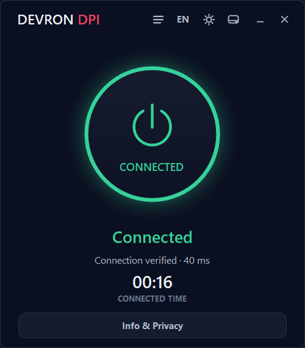
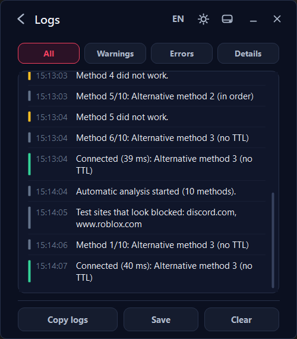
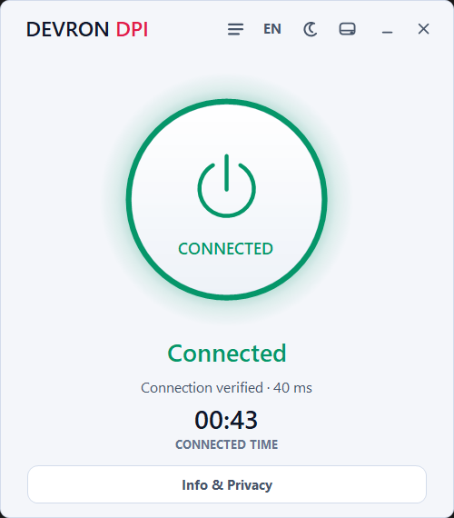

# DevronDPI

**One-click DPI bypass for Windows.** Reach Discord, Roblox and other sites your ISP blocks with deep packet inspection, no VPN needed.

🇹🇷 [Türkçe](README.md) &nbsp;|&nbsp; 🇬🇧 **English**

 

**[⬇ Download the latest release](../../releases/latest)** · Nothing to install. Run `DevronDPI.exe` and press **CONNECT**.

## What it does

- **Zero config.** Tests your network, finds a method that works and saves it per network (home Wi-Fi, phone hotspot…). Later connects are faster.
- **Not a VPN.** Traffic isn't routed through anyone's server, so ping and speed stay the same.
- **"Connected" means connected.** It only turns green after a real TLS handshake with blocked test sites succeeds.
- **Tells you what's wrong.** No internet, DNS, an IP block or DPI? If it can't connect, it shows the cause.
- **Discord voice.** Helps when you're stuck on "RTC Connecting".
- **Handles network changes.** Re-checks the connection when you switch Wi-Fi or wake the PC from sleep.
- **Portable, no telemetry.** A single exe; settings live in `%AppData%\DevronDPI`.

Also: run at startup, auto-connect on launch, background mode, global hotkey, Turkish/English UI, light/dark themes. Works system-wide on Windows x64.

## Screenshots

| Connected | Logs |
|:---:|:---:|
|  |  |
| **Notification area menu** | **Light theme** |
|  |  |

## Usage

1. Run `DevronDPI.exe`.
2. Press **CONNECT**. Windows asks for admin rights (UAC) the first time; click **Yes**.

The analysis takes a few seconds. Press the button again while it's connecting to cancel.

<b>Window, notification area and logs</b>

- **X** quits the app and disconnects. Turn on **Run in background** in the top bar and X and minimize will hide the window to the notification area instead.
- If the connection drops or comes back while the window is hidden, you get a Windows notification.
- **Notification area icon:** left-click opens the window. The right-click menu has connect/disconnect, **Run at startup**, **Connect automatically on launch** (off by default), hotkey, **Diagnose connection**, update check and **Exit**.
- **Logs:** shows the connection history. Filter by *All / Warnings / Errors*, expand technical lines with **Details**, copy them or save as `.txt`.

<b>Admin rights and "Run at startup"</b>

Capturing packets with WinDivert requires admin rights. The window runs unelevated; only the packet engine runs elevated, in a separate process, so screenshot tools and hotkeys work normally. The engine stops when the window closes.

When you turn on **Run at startup**, you approve UAC once. After that you won't be prompted at logon or when you press **CONNECT** (except possibly once on the first connect after an update). The option copies the exe to `C:\Program Files\DevronDPI\`, which only administrators can modify, and creates a scheduled task. Turning it off removes both. If you move the exe to another folder, toggle the option off and on once.

## Good to know

- **IP blocks can't be bypassed.** If a site is blocked by IP, no DPI tool can open it; you need a VPN. DevronDPI detects this and tells you.
- **"Connected" doesn't guarantee every site.** It means the test sites are reachable.
- **DNS isn't encrypted.** The domains you visit go in plain text to the selected DNS server. Your browser's own DoH/DoT isn't affected.
- **On company or school networks,** DNS redirection may stop internal hostnames from resolving.
- **The QUIC block** may affect VPNs that use UDP 443.
- DNS redirection can't be turned off from the UI. Global is the only profile that skips it, and it's tried last.

## Privacy

- No data collection, no telemetry. Settings and logs (`devron.conf`, `devron.log`, `devron-engine.log`) stay in `%AppData%\DevronDPI` on your PC.
- Connection tests only do a TLS handshake with the test sites. No page is downloaded and none of your data is sent. As with any connection, those sites see your IP address.
- Only two things go to third parties: **DNS queries** to the selected server (Yandex, OpenDNS, AdGuard or Quad9) and **update checks** to GitHub. Their own privacy policies apply.

## Security

- **Updates** come from GitHub, are never installed without your approval and are rejected if the SHA-256 hash doesn't match. See [CHANGELOG.md](CHANGELOG.md) for changes.
- **The exe isn't code-signed yet,** so you may see a SmartScreen or "Unknown publisher" warning. Only download it from the [releases](../../releases) page and compare the SHA-256 hash with the release notes.
- **Antivirus warnings** such as `RiskTool.WinDivert` are false positives caused by the WinDivert driver. WinDivert is a signed driver, also used by GoodbyeDPI. Add the exe to your exclusions if needed.

To report a vulnerability, see [SECURITY.md](SECURITY.md).

<b>How it works</b>

DPI systems usually identify the site you're visiting from the SNI field of the TLS ClientHello. DevronDPI captures outbound packets with WinDivert and rewrites them before they leave:

- **SNI splitting:** the ClientHello is split into several TCP segments so the DPI never sees the hostname in one piece.
- **Fake packets:** decoys with a low TTL, or an invalid sequence number or checksum, confuse the DPI. The TTL is picked so the decoy reaches the DPI box but expires before the server, based on the hop distance measured from the server's SYN-ACK (Auto-TTL).
- **DNS redirection:** UDP 53 queries go to Yandex DNS (`77.88.8.8`) on the non-standard port 1253, sidestepping DNS hijacking on port 53. If it doesn't answer, OpenDNS, AdGuard and Quad9 are tried.
- **QUIC blocking:** outbound UDP 443 is dropped, so browsers and Discord fall back from HTTP/3 to TLS over TCP.
- **Discord voice:** stalls are usually caused by the first UDP packet to the voice server being dropped. DevronDPI sends a harmless decoy right before it. The audio stream is left alone.

The analysis first tries whatever worked on this network last time, then the standard, alternative, light, fallback DNS and global profiles in order, and finally different split points. If there's no internet or the block is IP-level, it stops instead of trying in vain.

On port 443 only ClientHello packets reach user mode. Downloads, video and game traffic stay in the kernel, keeping CPU usage near zero.

## FAQ

<b>It says "Connected" but a site won't open.</b>

Run **Diagnose connection** from the notification area menu to see the cause. If the site is blocked by IP, DevronDPI can't open it. Details are on the **Logs** screen.

<b>Discord is stuck on "RTC Connecting".</b>

This usually clears up while DevronDPI is connected. It won't if the voice server's IP is blocked. Make sure you're connected and the Logs show no errors.

<b>My browser uses DoH. Is that a problem?</b>

No, your browser keeps using its own encrypted DNS.

<b>How do I uninstall it?</b>

First turn off **Run at startup** in the notification area menu (removes the scheduled task and the `Program Files` copy). Then delete `DevronDPI.exe`. Optionally delete `%AppData%\DevronDPI` (settings, logs) and `C:\ProgramData\DevronDPI` (driver files).

## Reporting issues

Open an issue on the [Issues](../../issues) page and include:

- The output of **Copy logs** on the **Logs** screen (your DevronDPI and Windows versions are at the top). As files: `%AppData%\DevronDPI\devron.log`, plus `devron-engine.log` for engine errors.
- What you did and what happened, with a screenshot if you can.

Logs may contain the hostnames of test sites, so take a quick look before posting them.

## License

Closed-source freeware, distributed under the [LICENSE](LICENSE) terms. © 2026 RRaynorr

WinDivert is licensed under LGPLv3. See [THIRD-PARTY-NOTICES.md](THIRD-PARTY-NOTICES.md) for other components.
