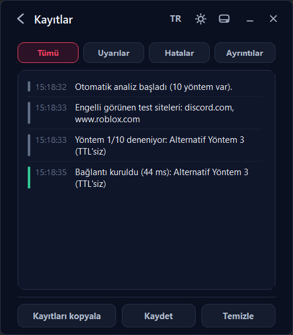
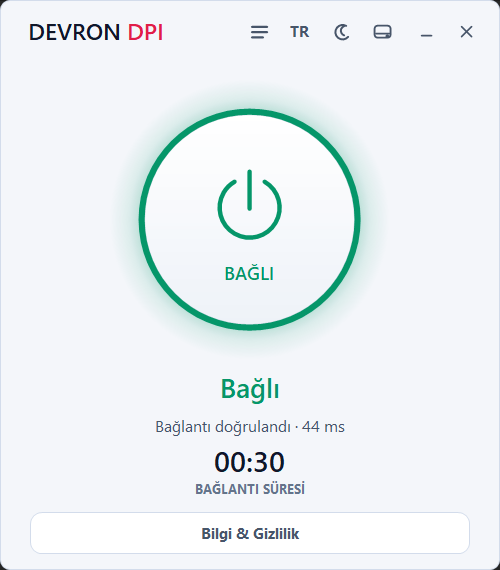

# DevronDPI

**Windows için tek tıkla DPI aşma aracı.** Discord, Roblox ve servis sağlayıcınızın DPI ile engellediği diğer sitelere VPN kullanmadan erişin.

🇬🇧 [English](README.en.md) &nbsp;|&nbsp; 🇹🇷 **Türkçe**

 

**[⬇ Son sürümü indir](../../releases/latest)** · Kurulum yok. `DevronDPI.exe`'yi çalıştırın, **BAĞLAN**'a basın.

## Neler yapar?

- **Ayar istemez.** Ağınızı test eder, çalışan yöntemi bulur ve her ağ için ayrı kaydeder (ev Wi-Fi'si, telefon hotspot'u…). Sonraki bağlantılar daha hızlı kurulur.
- **VPN değildir.** Trafik başka bir sunucudan geçmez, ping ve hız değişmez.
- **"Bağlı" gerçekten bağlı demektir.** Engelli test sitelerine TLS bağlantısı kurulamadan yeşil yanmaz.
- **Sorunu söyler.** İnternet yok mu, DNS mi, IP engeli mi, DPI mı? Bağlanamazsa nedenini gösterir.
- **Discord sesli sohbet.** "RTC Bağlanıyor"da takılma sorununa yardımcı olur.
- **Ağ değişince toparlanır.** Wi-Fi değişince ya da uykudan uyanınca bağlantıyı yeniden doğrular.
- **Taşınabilir, telemetri yok.** Tek exe; ayarlar `%AppData%\DevronDPI` içinde durur.

Ayrıca: başlangıçta çalıştırma, açılışta otomatik bağlanma, arka planda çalışma, kısayol tuşu, Türkçe/İngilizce arayüz, açık/koyu tema. Sistem genelinde çalışır, Windows x64 içindir.

## Ekran görüntüleri

| Bağlı | Kayıtlar |
|:---:|:---:|
|  |  |
| **Bildirim alanı menüsü** | **Açık tema** |
|  |  |

## Kullanım

1. `DevronDPI.exe`'yi çalıştırın.
2. **BAĞLAN**'a basın. İlk seferde Windows yönetici izni ister (UAC), **Evet** deyin.

Analiz birkaç saniye sürer. Bağlanırken düğmeye tekrar basarsanız işlem iptal edilir.

<b>Pencere, bildirim alanı ve kayıtlar</b>

- **X** uygulamayı kapatır ve bağlantıyı keser. Üst çubuktan **Arka planda çalış**'ı açarsanız X ve küçült düğmeleri pencereyi bildirim alanına gizler.
- Pencere açık değilken bağlantı koparsa ya da yeniden kurulursa Windows bildirimi gelir.
- **Bildirim alanı simgesi:** Sol tık pencereyi açar. Sağ tık menüsünde bağlan/kes, **Başlangıçta çalıştır**, **Açılışta otomatik bağlan** (varsayılan olarak kapalı), kısayol tuşu, **Bağlantıyı tanıla**, güncelleme kontrolü ve **Çıkış** bulunur.
- **Kayıtlar:** Bağlantı geçmişini gösterir. *Tümü / Uyarılar / Hatalar* ile süzülür, **Ayrıntılar** teknik satırları açar. Kayıtları kopyalayabilir ya da `.txt` olarak kaydedebilirsiniz.

<b>Yönetici izni ve "Başlangıçta çalıştır"</b>

WinDivert ile paket yakalamak yönetici yetkisi gerektirir. Pencere normal yetkiyle çalışır, yalnızca paket motoru ayrı bir süreçte yönetici olarak başlar. Bu sayede ekran görüntüsü araçları ve kısayollar etkilenmez. Pencere kapanınca motor da durur.

**Başlangıçta çalıştır**'ı açarken izni bir kez verirsiniz. Sonrasında ne Windows açılışında ne de **BAĞLAN**'a basınca UAC sorulmaz (yalnızca bir güncellemeden sonraki ilk bağlantıda bir kez daha sorulabilir). Bu seçenek exe'nin bir kopyasını, yalnızca yöneticilerin değiştirebildiği `C:\Program Files\DevronDPI\` klasörüne koyar ve bir zamanlanmış görev oluşturur. Seçeneği kapattığınızda ikisi de silinir. Exe'yi başka bir klasöre taşırsanız seçeneği bir kez kapatıp açın.

## Bilmeniz gerekenler

- **IP engelini aşamaz.** Site IP düzeyinde engelliyse hiçbir DPI aracı açamaz, VPN gerekir. DevronDPI bunu fark eder ve söyler.
- **"Bağlı" her sitenin açılacağı anlamına gelmez,** test sitelerine erişilebildiğini gösterir.
- **DNS sorguları şifrelenmez.** Girdiğiniz alan adları seçilen DNS sunucusuna şifresiz gider. Tarayıcının kendi DoH/DoT ayarı etkilenmez.
- **Şirket ve okul ağlarında** DNS yönlendirmesi yüzünden iç alan adları çözülemeyebilir.
- **QUIC engeli** nedeniyle UDP 443 kullanan bazı VPN'ler etkilenebilir.
- DNS yönlendirmesi arayüzden kapatılamaz. Yönlendirme yapmayan tek profil Global'dir ve en son denenir.

## Gizlilik

- Veri toplanmaz, telemetri yoktur. Ayarlar ve kayıtlar (`devron.conf`, `devron.log`, `devron-engine.log`) yalnızca `%AppData%\DevronDPI` klasöründe tutulur.
- Bağlantı testleri test siteleriyle yalnızca TLS el sıkışması yapar. Sayfa indirilmez, veri gönderilmez. Siteler, her bağlantıda olduğu gibi IP adresinizi görür.
- Üçüncü taraflara yalnızca iki şey gider: **DNS sorguları** seçilen sunucuya (Yandex, OpenDNS, AdGuard veya Quad9), **güncelleme kontrolü** GitHub'a. Bu hizmetlerin kendi gizlilik politikaları geçerlidir.

## Güvenlik

- **Güncellemeler** GitHub'dan alınır, onayınız olmadan kurulmaz ve SHA-256 özeti eşleşmezse reddedilir. Değişiklikler için [CHANGELOG.md](CHANGELOG.md).
- **Exe henüz imzalı değil.** Bu yüzden SmartScreen ya da "Yayıncı bilinmiyor" uyarısı çıkabilir. Yalnızca [sürümler](../../releases) sayfasından indirin ve SHA-256 özetini sürüm notlarıyla karşılaştırın.
- **Antivirüs uyarıları** (`RiskTool.WinDivert` gibi) WinDivert sürücüsünden kaynaklanan yanlış alarmlardır. WinDivert, GoodbyeDPI'ın da kullandığı imzalı bir sürücüdür. Gerekirse exe'yi istisnalara ekleyin.

Güvenlik açığı bildirmek için [SECURITY.md](SECURITY.md).

<b>Nasıl çalışır?</b>

DPI sistemleri girdiğiniz siteyi genellikle TLS ClientHello paketindeki SNI alanından tanır. DevronDPI, WinDivert ile giden paketleri yakalar ve gönderilmeden önce düzenler:

- **SNI bölme:** ClientHello birkaç TCP segmentine bölünür, böylece DPI alan adını tek parça hâlinde göremez.
- **Sahte paketler:** Düşük TTL'li ya da geçersiz sequence/checksum değerli sahte paketler DPI'ı yanıltır. TTL, paket DPI'a ulaşıp sunucuya varmadan düşecek şekilde, sunucunun SYN-ACK paketinden ölçülen hop mesafesine göre hesaplanır (Auto-TTL).
- **DNS yönlendirme:** UDP 53 sorguları Yandex DNS'e (`77.88.8.8`) standart olmayan 1253 portundan gider. Böylece 53. porttaki DNS müdahalesi atlatılır. Yanıt gelmezse OpenDNS, AdGuard ve Quad9 denenir.
- **QUIC engeli:** Giden UDP 443 düşürülür, tarayıcılar ve Discord HTTP/3 yerine TCP üzerinden TLS kullanır.
- **Discord sesli sohbet:** Takılmanın yaygın nedeni, ses sunucusuna giden ilk UDP paketinin engellenmesidir. DevronDPI bu paketin hemen önüne zararsız bir sahte paket ekler. Ses akışına dokunmaz.

Analiz önce bu ağda daha önce çalışan yöntemi dener. Sonra sırasıyla standart, alternatif, hafif, yedek DNS ve global profillere, en son da farklı bölme noktalarına geçer. İnternet yoksa ya da engel IP düzeyindeyse boşuna denemeye devam etmez.

443. portta yalnızca ClientHello paketleri kullanıcı moduna gelir. İndirme, video ve oyun trafiği çekirdekte kalır, CPU kullanımı neredeyse sıfırdır.

## SSS

<b>"Bağlı" yazıyor ama bir site açılmıyor.</b>

Bildirim alanı menüsünden **Bağlantıyı tanıla**'yı çalıştırın, nedenini gösterir. Site IP düzeyinde engelliyse DevronDPI açamaz. Ayrıntılar **Kayıtlar** ekranında.

<b>Discord "RTC Bağlanıyor"da takılı kalıyor.</b>

DevronDPI bağlıyken genellikle düzelir. Ses sunucusunun IP adresi engelliyse düzelmez. Bağlı olduğunuzdan ve Kayıtlar'da hata olmadığından emin olun.

<b>Tarayıcım DoH kullanıyor, sorun olur mu?</b>

Hayır, tarayıcınız kendi şifreli DNS'ini kullanmaya devam eder.

<b>Nasıl kaldırırım?</b>

Önce bildirim alanı menüsünden **Başlangıçta çalıştır**'ı kapatın (zamanlanmış görevi ve `Program Files` kopyasını siler). Sonra `DevronDPI.exe`'yi silin. İsterseniz `%AppData%\DevronDPI` (ayarlar, kayıtlar) ve `C:\ProgramData\DevronDPI` (sürücü dosyaları) klasörlerini de silin.

## Sorun bildirme

[Issues](../../issues) sayfasından kayıt açın ve şunları ekleyin:

- **Kayıtlar** ekranındaki **Kayıtları kopyala** çıktısı (DevronDPI ve Windows sürümü en baştadır). Dosya olarak isterseniz: `%AppData%\DevronDPI\devron.log` ve motor hataları için `devron-engine.log`.
- Ne yaptığınız ve ne olduğu, mümkünse ekran görüntüsü.

Kayıtlarda test sitelerinin adları geçebilir, paylaşmadan önce bir göz atın.

## Lisans

Ücretsiz (freeware) ve kapalı kaynak, [LICENSE](LICENSE) koşullarıyla dağıtılır. © 2026 RRaynorr

WinDivert LGPLv3 lisanslıdır. Diğer bileşenler için [THIRD-PARTY-NOTICES.md](THIRD-PARTY-NOTICES.md).
