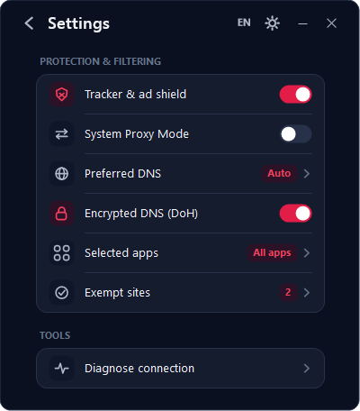
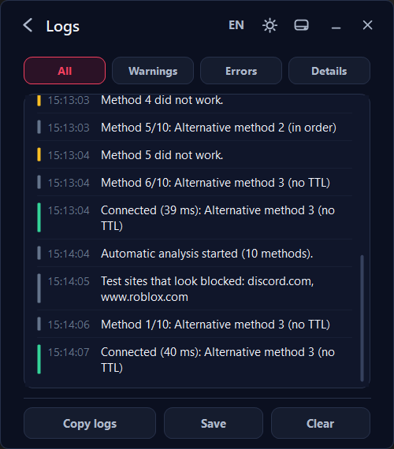
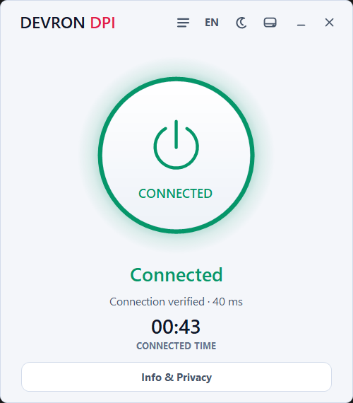
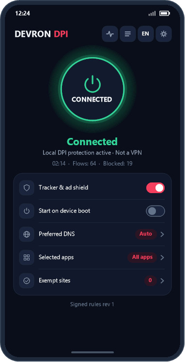
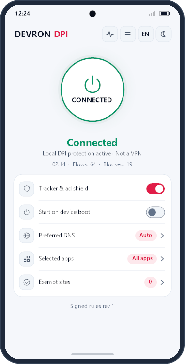

# DevronDPI

**One-click DPI bypass for Windows & Android.** Reach websites, apps, online games and voice platforms restricted by your ISP's deep packet inspection (DPI) — no VPN, no speed or ping loss.

🇬🇧 **English** &nbsp;|&nbsp; 🇹🇷 [Türkçe](README.tr.md) &nbsp;·&nbsp; 💻 [Windows](#windows-devrondpiexe) &nbsp;|&nbsp; 📱 [Android](#android-devrondpiapk)

     

**[⬇ Download the latest release (Windows `.exe` & Android `.apk`)](../../releases/latest)**

---

## Windows (`DevronDPI.exe`)

Nothing to install — run `DevronDPI.exe` and press **CONNECT**. Works on **Windows 10/11 x64** and **Windows ARM64**.

| Connected | In-App Settings |
|:---:|:---:|
|  |  |
| **Logs & Live Metrics** | **Light Theme** |
|  |  |

### Key features (Windows)

- **Zero config & network memory.** Tests your network, finds a method that works and saves it per network (home Wi-Fi, hotspot…). Later connects are faster.
- **Not a VPN.** Traffic goes straight to its destination, so ping and speed stay the same.
- **"Connected" means connected.** Only turns green after verifying a working encrypted connection with blocked test sites.
- **In-app Settings & streamlined tray menu.** Manage every option cleanly inside the window's **Settings** screen with sliding sub-pages, leaving a compact 5-item notification area menu.
- **Encrypted DNS (DoH) & Preferred DNS.** Choose **Auto, Yandex, OpenDNS, AdGuard, Quad9 or Cloudflare**, and toggle **Encrypted DNS (DoH)** to tunnel system DNS over HTTPS with automatic failover and LAN/Captive Portal exemption.
- **Anycast access bridge.** Routes directly blocked provider IPs (`1.1.1.1`, `9.9.9.9`, etc.) to a certificate-verified alternative Anycast IP of the same provider.
- **Driverless System Proxy Mode (ARM64 & non-admin PCs).** Run locally via loopback proxy without the WinDivert driver or admin rights (auto-enabled on Windows ARM64).
- **Visual Selected Apps picker.** Pick running apps with icons and live search under **Settings → Selected apps** to protect only chosen apps, or clear to protect the entire system.
- **4-stage Connection X-Ray & 8-site Quick Test.** Live timings for `1. DNS → 2. TCP → 3. TLS SNI → 4. 24 KB Flow`, parallel **8-site Quick Test**, and verified **Apply Working Rule** / **Add to Exempt List** actions.
- **Game, anti-cheat, public & custom exemptions.** Passes `.gov`, `.edu` and gaming/anti-cheat backends (`Riot/Vanguard`, `Steam`, `Battle.net`, `EasyAntiCheat`, `BattlEye`) untouched; add your own domains under **Settings → Exempt sites**.
- **Tracker & ad shield (optional, 0 ms).** Blocks known ad, tracker and telemetry domains locally without decrypting HTTPS or installing certificates, with a live blocked counter on Home.
- **Discord voice & automatic recovery.** Helps prevent "RTC Connecting" stalls, and automatically re-verifies protection after Wi-Fi changes, sleep or lock screen.
- **5 languages, live theme sync & portable USB mode.** English (default), Turkish, Russian, Persian (RTL) and Spanish, live Windows Dark/Light sync, one-click settings backup/restore, `portable.flag` USB mode, and RSA-2048 signed rule updates (`rules.json`).

<b>Windows usage, notification area menu and admin rights</b>

1. Run `DevronDPI.exe` and press **CONNECT**. Windows asks for admin rights (UAC) the first time in driver mode — click **Yes** (or turn on **System Proxy Mode** in Settings to run without admin rights).
2. The analysis takes a few seconds; press the button again while connecting to cancel.
3. Turn on **Run in background** to hide to the notification area on close/minimize, with live Windows drop/reconnect notifications.
4. **Run at startup** approves UAC once and copies the exe to `C:\Program Files\DevronDPI\` with a scheduled task so you aren't prompted again. Turning it off removes both.

---

## Android (`DevronDPI.apk`)

Standalone **rootless** Material 3 app for **Android 10+** (`3.5 MB` signed APK · **0/67** on VirusTotal). Uses Android's local on-device `VpnService` — **not an external VPN**, no remote server, no speed or ping loss.

| Dark Mode (Connected) | Light Mode (Connected) |
|:---:|:---:|
|  |  |

### Key features (Android)

- **Rootless on-device DPI bypass.** Splits TLS `ClientHello` records & TCP segments locally, blocks QUIC (UDP 443) so browsers and Discord fall back to TCP TLS, and prevents dual-stack 4G/5G IPv6 DPI leaks.
- **Per-app protection.** Choose exactly which apps go through DevronDPI with icons and search, or protect all apps.
- **Preferred DNS & fast cache.** Pick **Auto, Yandex, OpenDNS, AdGuard, Quad9 or Cloudflare** with non-standard-port fallback and instant local response caching.
- **Tracker & ad shield.** Toggle local 0-ms ad/tracker blocking with live protected-flow and blocked counters.
- **4-stage Connection X-Ray & parallel 8-site test.** Tap the pulse icon in the top bar to probe any domain or run a parallel 8-site benchmark with one-click copy.
- **Quick Settings tile & auto-start on boot.** Toggle DevronDPI directly from Android's notification shade or start automatically when your phone boots.
- **5 languages, Dark/Light/System theme & signed rules.** English, Turkish, Russian, Persian (RTL) and Spanish, Material 3 themes, live logs viewer, and shared RSA-2048 signed `rules.json` updates.

### Android installation

1. Download `DevronDPI.apk` from the [latest release](../../releases/latest) on Android 10 or newer.
2. Install the APK (allow installing unknown apps when prompted by Android).
3. Open **DevronDPI**, tap **CONNECT**, and approve Android's local VPN dialog once. Optionally add the **DevronDPI** Quick Settings tile from your notification shade.

---

## Good to know

- **General IP blocks can't be bypassed.** If a site is directly blocked by IP (aside from supported Anycast providers), no DPI tool can open it; you need a VPN. DevronDPI detects this and tells you.
- **"Connected" doesn't guarantee every site.** It means the test sites are reachable.
- **Encrypted DNS (DoH) is optional.** Turn on **Encrypted DNS (DoH)** in Windows Settings to encrypt system DNS lookups over HTTPS. When off, system DNS queries go over UDP to your selected DNS server (local/LAN names automatically bypass DoH).
- **On company or school networks,** DNS redirection may stop internal hostnames from resolving.
- **The QUIC block** may affect VPNs that use UDP 443.
- **Android VPN slot:** Android allows only one active `VpnService` at a time, so DevronDPI cannot run simultaneously with another VPN app on Android.

## Privacy

- No data collection, no telemetry. On Windows, settings and logs (`devron.conf`, `devron.log`, `devron-engine.log`, `rules.cache.json`) stay in `%AppData%\DevronDPI` (or beside the exe in portable mode). On Android, preferences and cached signed rules stay in private app storage.
- Connection and diagnostic checks only verify the encrypted handshake and initial response with the tested addresses; none of your personal data is sent. As with any connection, those sites see your IP address.
- Only two things go to third parties: **DNS queries** to the selected provider (Yandex, OpenDNS, AdGuard, Quad9 or Cloudflare) and **update / signed rule checks** to GitHub. Their own privacy policies apply.

## Security

- **Updates** come from GitHub, are never installed without your approval and are rejected if the SHA-256 hash doesn't match. See [CHANGELOG.md](CHANGELOG.md) for changes.
- **Signed rule updates (`rules.json`)** are verified against an embedded RSA-2048 public key on both Windows and Android. Unsigned, tampered, or out-of-range bundles are rejected; no code or commands can be executed.
- **The Windows exe isn't code-signed yet,** so you may see a Windows SmartScreen or "Unknown publisher" warning. Only download it from the [releases](../../releases) page and compare the SHA-256 hash with the release notes.
- **Antivirus warnings** such as `RiskTool.WinDivert` are false positives caused by the packet-capture driver (WinDivert). WinDivert is a Microsoft-signed driver, also used by GoodbyeDPI. Add the exe to your exclusions if needed.

To report a vulnerability, see [SECURITY.md](SECURITY.md).

<b>How it works</b>

DPI systems usually identify the site you're visiting from the SNI field of the TLS ClientHello. DevronDPI processes outbound connection setup locally on your device before packets leave:

- **SNI splitting:** the ClientHello is split into separate segments so the DPI never sees the hostname in one piece.
- **Auto-TTL & smart protection:** on Windows driver mode, the hop distance measured from the server's SYN-ACK is used to tune delivery parameters automatically.
- **DNS redirection & Encrypted DNS (DoH):** UDP 53 queries are redirected to clean non-standard-port DNS (Yandex :1253, OpenDNS :5353, AdGuard :5353) or tunneled over HTTPS when **Encrypted DNS (DoH)** is enabled on Windows.
- **Anycast bridge:** when `1.1.1.1`, `9.9.9.9`, `208.67.222.222`, `8.8.8.8` or `94.140.14.14` is directly blocked, traffic is routed to an OS-certificate-verified alternative Anycast IP of the same provider.
- **QUIC blocking:** outbound UDP 443 is dropped, so browsers and Discord fall back from HTTP/3 to TLS over TCP.
- **Android on-device tunnel:** uses Android's local `VpnService` with `hevtunnel` (`hev-socks5-tunnel`) and an on-device DPI proxy — no external server and no root required.

On Windows driver mode port 443, only initial handshake packets reach user mode. Downloads, video and game traffic stay in the kernel, keeping CPU usage near zero.

## FAQ

<b>It says "Connected" but a site won't open.</b>

Open **Settings → Diagnose connection** (or the pulse icon on Android) and enter that site's address to run the 4-stage Connection X-Ray. On Windows, if an alternative method or exempting the site works, DevronDPI verifies it and offers a one-click fix. Direct IP blocks require a VPN.

<b>Discord is stuck on "RTC Connecting".</b>

This usually clears up while DevronDPI is connected. It won't if the voice server's IP is blocked. Make sure you're connected and the Logs show no errors.

<b>How does Encrypted DNS (DoH) work with Auto DNS?</b>

When **Preferred DNS** is set to **Auto** and **Encrypted DNS (DoH)** is turned on, DevronDPI automatically picks a working DoH provider and fails over seamlessly if one is unreachable — while keeping local network and Captive Portal addresses exempt.

<b>How do I uninstall it?</b>

On Windows: first turn off **Run at startup** in Settings (removes the scheduled task and the `Program Files` copy), then delete `DevronDPI.exe`. Optionally delete `%AppData%\DevronDPI` and `C:\ProgramData\DevronDPI`. On Android: uninstall the app normally from Android Settings.

## Reporting issues

Open an issue on the [Issues](../../issues) page and include:

- The output of **Copy logs** on the **Logs** screen (includes version, method summary, counters and engine logs).
- Your platform (Windows or Android), what you did and what happened, with a screenshot if you can.

Logs may contain the hostnames of tested sites, so take a quick look before posting them.

## License

Closed-source freeware, distributed under the [LICENSE](LICENSE) terms. © 2026 RRaynorr

Windows uses WinDivert (LGPLv3) and Android uses `hevtunnel` / `hev-socks5-tunnel` (Apache-2.0 / MIT / BSD-3-Clause). See [THIRD-PARTY-NOTICES.md](THIRD-PARTY-NOTICES.md) for full details.
