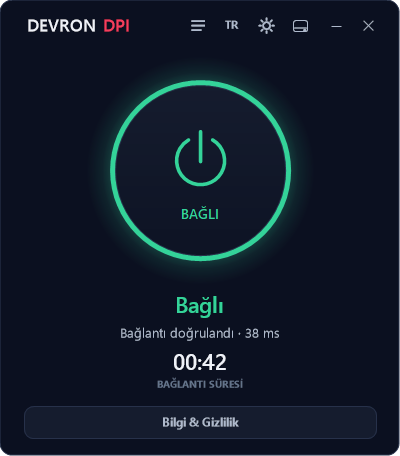
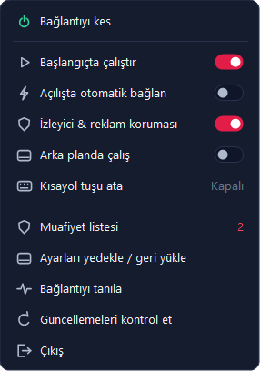

# DevronDPI

**Windows için tek tıkla DPI aşma aracı.** Discord, Roblox ve internet servis sağlayıcınızın derin paket denetimiyle (DPI) engellediği sitelere VPN kullanmadan erişin.

🇬🇧 [English](README.en.md) &nbsp;|&nbsp; 🇹🇷 **Türkçe**

 

**[⬇ Son sürümü indir](../../releases/latest)** · Kurulum gerektirmez. `DevronDPI.exe` dosyasını çalıştırın ve **BAĞLAN** düğmesine basın.

## Neler yapar?

- **Ayar istemez.** Ağınızı test eder, çalışan yöntemi bulur ve her ağ için ayrı kaydeder (ev ağı, telefonun mobil erişim noktası vb.). Sonraki bağlantılar daha hızlı kurulur.
- **VPN değildir.** Trafik başka bir sunucudan geçmez; gecikme süresi (ping) ve hız değişmez.
- **"Bağlı" gerçekten bağlı demektir.** Engelli test siteleriyle güvenli bağlantı doğrulanmadan yeşil yanmaz.
- **Sorunu açıklar.** İnternet mi yok, DNS engeli mi var, IP engeli mi, yoksa DPI mı? Bağlanamazsa nedenini gösterir; isterseniz açılmayan tek bir adresi de kontrol edebilirsiniz.
- **Şifreli DNS (DoH) ve Anycast köprüsü.** Ağınızda `1.1.1.1` veya `9.9.9.9` gibi bilinen sağlayıcı IP adresleri doğrudan engelliyse bağlantıyı aynı sağlayıcıya ait sertifika doğrulamalı alternatif Anycast IP adresine yönlendirir.
- **Discord sesli sohbet.** "RTC Bağlanıyor" aşamasında takılma sorununa yardımcı olur.
- **Ağ değişince toparlanır.** Kablosuz ağ değiştiğinde ya da bilgisayar uykudan uyandığında internetin gelmesini bekler ve bağlantıyı yeniden doğrular.
- **Kamu ve akademik sitelere dokunmaz.** `.gov`, `.edu` ve ülke bazlı kamu/üniversite uzantılarının (`.gov.tr`, `.edu.tr`, `.gov.uk`, `.ac.uk`, `.gouv.fr`, `.gob.es` vb.) paketlerini bölmeden doğrudan geçirir.
- **Taşınabilirdir, veri toplamaz.** Tek dosyadan çalışır; ayarlar `%AppData%\DevronDPI` klasöründe tutulur.

Ayrıca başlangıçta çalıştırma, açılışta otomatik bağlanma, arka planda çalışma, kısayol tuşu, Türkçe/İngilizce arayüz, açık ve koyu tema seçenekleri bulunur. Sistem genelinde çalışır, 64-bit Windows içindir.

## Ekran görüntüleri

| Bağlı | Kayıtlar |
|:---:|:---:|
|  |  |
| **Bildirim alanı menüsü** | **Açık tema** |
|  |  |

## Kullanım

1. `DevronDPI.exe` dosyasını çalıştırın.
2. **BAĞLAN** düğmesine basın. İlk bağlantıda Windows yönetici izni ister; **Evet** diyerek onaylayın.

Analiz birkaç saniye sürer. Bağlanırken düğmeye tekrar basarsanız işlem iptal edilir.

<b>Pencere, bildirim alanı ve kayıtlar</b>

- **X** düğmesi uygulamayı kapatır ve bağlantıyı keser. Üst çubuktan **Arka planda çalış** seçeneğini açarsanız X ve küçült düğmeleri pencereyi bildirim alanına gizler.
- Pencere açık değilken bağlantı koparsa ya da yeniden kurulursa Windows bildirimi gösterilir.
- **Bildirim alanı simgesi:** Sol tıklama pencereyi açar. Sağ tıklama ile açılan bildirim alanı menüsünde bağlan/kes, **Başlangıçta çalıştır**, **Açılışta otomatik bağlan** (varsayılan olarak kapalıdır), kısayol tuşu, **Bağlantıyı tanıla** (genel kontrol veya tek bir adres testi), güncelleme kontrolü ve **Çıkış** yer alır.
- **Kayıtlar:** Bağlantı geçmişini gösterir. *Tümü / Uyarılar / Hatalar / Ayrıntılar* sekmeleriyle filtrelenir (**Ayrıntılar** teknik satırları da listeler). **Kayıtları kopyala** düğmesiyle tanılama özetini ve motor kayıtlarını tek seferde panoya alabilir ya da `.txt` dosyası olarak kaydedebilirsiniz.

<b>Yönetici izni ve "Başlangıçta çalıştır"</b>

WinDivert ile paket yakalamak yönetici yetkisi gerektirir. Pencere normal kullanıcı yetkisiyle çalışır; yalnızca paket motoru ayrı bir süreçte yönetici olarak başlar. Bu sayede ekran görüntüsü araçları ve kısayollar kesintiye uğramaz. Pencere kapanınca motor da durur.

**Başlangıçta çalıştır** seçeneğini açarken yönetici iznini bir kez verirsiniz. Sonrasında ne Windows açılışında ne de **BAĞLAN** düğmesine basıldığında yeniden onay istenir (yalnızca güncelleme sonrasındaki ilk bağlantıda bir kez daha sorulabilir). Bu seçenek `DevronDPI.exe` dosyasının bir kopyasını, yalnızca yöneticilerin değiştirebildiği `C:\Program Files\DevronDPI\` klasörüne yerleştirir ve zamanlanmış bir görev oluşturur. Seçeneği kapattığınızda ikisi de kaldırılır. Dosyayı başka bir klasöre taşırsanız bu seçeneği bir kez kapatıp yeniden açın.

## Bilmeniz gerekenler

- **Genel IP engelini aşamaz.** Bir site doğrudan IP adresi düzeyinde engelliyse (desteklenen Anycast sağlayıcıları dışında) hiçbir DPI aracı bu engeli aşamaz, VPN gerekir. DevronDPI bu durumu tespit eder ve açıklar.
- **"Bağlı" durumu her sitenin açılacağı anlamına gelmez;** ağınızda engelli görünen test sitelerine erişilebildiğini gösterir.
- **Sistem DNS sorguları şifrelenmez.** Alan adı sorguları seçilen DNS sunucusuna şifresiz iletilir. Tarayıcınızın kendi şifreli DNS (DoH) ayarı ise etkilenmez; Anycast köprüsü sayesinde engelli ağlarda da çalışmayı sürdürür.
- **Şirket ve okul ağlarında** DNS yönlendirmesi nedeniyle yerel ağdaki iç alan adları çözülemeyebilir.
- **QUIC engeli** nedeniyle UDP 443 portunu kullanan bazı VPN uygulamaları etkilenebilir.
- DNS yönlendirmesi arayüzden kapatılamaz. Yönlendirme yapmayan tek yöntem Global seçeneğidir ve en son sırada denenir.

## Gizlilik

- Veri toplanmaz, telemetri bulunmaz. Ayarlar ve kayıtlar (`devron.conf`, `devron.log`, `devron-engine.log`) yalnızca `%AppData%\DevronDPI` klasöründe tutulur.
- Bağlantı ve tanılama kontrollerinde test edilen adreslerle yalnızca TLS bağlantı kurulumu ve kısa veri akışı doğrulaması yapılır; kişisel bir veri gönderilmez. Bağlanılan her sitede olduğu gibi karşı sunucu IP adresinizi görür.
- Üçüncü taraflara yalnızca iki bilgi gider: **DNS sorguları** seçilen sunucuya (Yandex, OpenDNS, AdGuard veya Quad9), **güncelleme kontrolü** ise GitHub sunucularına. Bu hizmetlerin kendi gizlilik politikaları geçerlidir.

## Güvenlik

- **Güncellemeler** GitHub üzerinden alınır, onayınız olmadan kurulmaz ve SHA-256 özeti eşleşmezse reddedilir. Sürüm geçmişi için [CHANGELOG.md](CHANGELOG.md) dosyasına bakabilirsiniz.
- **Uygulama dosyası henüz dijital imzalı değildir.** Bu nedenle Windows SmartScreen ya da "Yayıncı bilinmiyor" uyarısı görünebilir. Uygulamayı yalnızca [sürümler](../../releases) sayfasından indirin ve SHA-256 özetini sürüm notlarıyla karşılaştırın.
- **Antivirüs uyarıları** (`RiskTool.WinDivert` vb.), paket yakalama sürücüsünden (WinDivert) kaynaklanan yanlış alarmlardır. WinDivert, GoodbyeDPI uygulamasının da kullandığı Microsoft imzalı resmî bir sürücüdür. Gerekirse `DevronDPI.exe` dosyasını antivirüs istisnalarına ekleyebilirsiniz.

Güvenlik açığı bildirmek için [SECURITY.md](SECURITY.md) dosyasını inceleyin.

<b>Nasıl çalışır?</b>

DPI sistemleri bağlandığınız siteyi genellikle TLS `ClientHello` paketindeki SNI alanından tanır. DevronDPI, WinDivert aracılığıyla giden paketleri yakalar ve gönderilmeden önce bilgisayarınızda yeniden düzenler:

- **SNI bölme:** `ClientHello` paketi birkaç TCP parçasına bölünür; böylece DPI sistemi alan adını tek parça hâlinde göremez.
- **Sahte paketler:** Düşük TTL değerli ya da geçersiz TCP Seq, Checksum veya TCP MD5 seçeneği taşıyan sahte paketler DPI sistemini yanıltır. Uygun TTL değeri, paket DPI cihazına ulaşıp hedef sunucuya varmadan düşecek biçimde, sunucunun `SYN-ACK` yanıtından ölçülen ağ yönlendirici (hop) mesafesine göre otomatik hesaplanır (Auto-TTL).
- **DNS yönlendirme:** UDP 53 sorguları Yandex DNS sunucusuna (`77.88.8.8`) standart olmayan 1253 portundan iletilir. Yanıt alınamazsa sırasıyla OpenDNS, AdGuard ve Quad9 denenir; büyük yanıtlarda doğrulanan TCP DNS yedeği devreye girer.
- **Anycast köprüsü:** `1.1.1.1`, `9.9.9.9`, `208.67.222.222`, `8.8.8.8` veya `94.140.14.14` doğrudan engelliyse bağlantı, işletim sisteminin sertifika deposuyla doğrulanan alternatif Anycast IP adresine yönlendirilir.
- **QUIC engeli:** Giden UDP 443 paketleri düşürülür; böylece tarayıcılar ve Discord HTTP/3 yerine TCP üzerinden TLS kullanır.
- **Discord sesli sohbet:** Ses sunucusuna giden ilk 74 baytlık keşif paketinin hemen önüne zararsız bir sahte paket eklenir. Ses akışına dokunulmaz.

Analiz önce bu ağda daha önce çalışan yöntemi dener; ardından sırasıyla standart, alternatif, hafif, yedek DNS ve global yöntemlere, en son da farklı bölme noktalarına geçer.

443 numaralı portta yalnızca ilk bağlantı paketleri kullanıcı moduna alınır. İndirme, video ve oyun trafiği işletim sistemi çekirdeğinde kalır; işlemci kullanımı sıfıra yakındır.

## Sıkça sorulan sorular

<b>"Bağlı" yazıyor ama bir site açılmıyor.</b>

Bildirim alanı menüsünden **Bağlantıyı tanıla** penceresini açıp o sitenin adresini yazın; sorunun DNS, IP engeli veya derin DPI kaynaklı olup olmadığını gösterir. Site doğrudan IP düzeyinde engelliyse VPN kullanmanız gerekir.

<b>Discord "RTC Bağlanıyor" aşamasında takılı kalıyor.</b>

DevronDPI bağlıyken bu sorun genellikle düzelir. Ses sunucusunun IP adresi doğrudan engelliyse açılamaz. Bağlı olduğunuzdan ve **Kayıtlar** ekranında hata bulunmadığından emin olun.

<b>Tarayıcım şifreli DNS (DoH) kullanıyor, sorun olur mu?</b>

Hayır. Tarayıcınız kendi şifreli DNS ayarını kullanmaya devam eder; üstelik Cloudflare (`1.1.1.1`) veya Quad9 (`9.9.9.9`) ağınızda engelliyse Anycast köprüsü sayesinde DoH bağlantısı da çalışır.

<b>Uygulamayı nasıl kaldırırım?</b>

Önce bildirim alanı menüsünden **Başlangıçta çalıştır** seçeneğini kapatın (zamanlanmış görevi ve `Program Files` kopyasını siler). Ardından `DevronDPI.exe` dosyasını silin. İsterseniz `%AppData%\DevronDPI` (ayarlar ve kayıtlar) ile `C:\ProgramData\DevronDPI` (sürücü dosyaları) klasörlerini de silebilirsiniz.

## Sorun bildirme

[Sorunlar (Issues)](../../issues) sayfasından yeni kayıt açıp şunları ekleyin:

- **Kayıtlar** ekranındaki **Kayıtları kopyala** çıktısı (uygulama sürümü, yöntem özeti, sayaçlar ve motor kayıtları içindedir).
- Ne yaptığınız ve neyle karşılaştığınız, mümkünse ekran görüntüsü.

Kayıtlarda test edilen sitelerin adları yer alabilir; paylaşmadan önce gözden geçirin.

## Lisans

Ücretsiz ve kapalı kaynaklıdır; [LICENSE](LICENSE) koşullarıyla dağıtılır. © 2026 RRaynorr

WinDivert bileşeni LGPLv3 lisanslıdır. Ayrıntılar ve kendi WinDivert sürümünüzü kullanma bilgisi için [THIRD-PARTY-NOTICES.md](THIRD-PARTY-NOTICES.md) dosyasına bakın.
