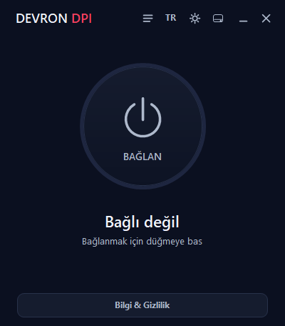

# DevronDPI

**Engelli sitelere tek tıkla erişin. Ayar yok, VPN yok, ping kaybı yok.**

🇬🇧 [English](README.en.md) &nbsp;|&nbsp; 🇹🇷 **Türkçe**

**[⬇ DevronDPI.exe'yi indir](../../releases/latest)** · Çift tıklayın, **BAĞLAN**'a basın. Kurulum gerekmez.

Windows (x64) için DPI (derin paket denetimi) aşım aracı. Discord, Roblox ve internet servis sağlayıcınızın paket denetimiyle kısıtladığı diğer sitelere bağlanmanızı sağlar. Tarayıcılar, Discord ve oyunlar dahil tüm uygulamalarda sistem genelinde çalışır.

## ✨ Neden DevronDPI?

- 🎯 **Tek tık, gerisi otomatik.** Ayar menüsü, profil seçimi, komut satırı yok. BAĞLAN'a basın; uygulama ağınızı test eder, çalışan yöntemi bulur ve **her ağ için ayrı hatırlar** (ev Wi-Fi'si, telefon paylaşımı…). Sonraki bağlantılar daha hızlıdır.
- 🧠 **Kolay pes etmez.** Hazır yöntemler işe yaramazsa başka yöntemleri kendisi dener, yanıt vermeyen DNS sunucularını atlar.
- ⚡ **VPN değildir, yavaşlatmaz.** Trafiğiniz başka bir sunucuya gitmez, doğrudan hedefe ulaşır. Ping ve hızınızı etkilemez; oyun ve Discord sesli sohbeti için idealdir.
- ✅ **"Bağlı" derse gerçekten bağlıdır.** Yeşil durum, bu ağda engelli görünen sitelere (Discord, Roblox, YouTube, Instagram gibi) gerçek bir güvenli bağlantı kurulabildiğinde yanar.
- 🩺 **Olmazsa nedenini söyler.** İnternet mi yok, DNS mi engelli, IP mi engelli, DPI mı? Sade bir dille açıklar.

### Ayrıca

- 🎧 **Discord sesli sohbet desteği:** "RTC Bağlanıyor" ekranında takılıp kalmanın yaygın nedeni olan engellenmiş ilk ses paketini aşmaya yardım eder. Ses sunucusunun IP adresi doğrudan engelliyse bunu aşamaz.
- 🔄 **Ağ değişince kendini toparlar:** Wi-Fi değiştiğinde ya da bilgisayar uykudan uyandığında bağlantıyı yeniden doğrular.
- 📦 **Tek dosya, kurulum yok:** taşınabilir `DevronDPI.exe`; istediğiniz klasörden ya da USB bellekten çalışır.
- 🕶️ **Gizliliğiniz sizde:** geliştirici tarafında hiçbir veri toplanmaz ve saklanmaz; telemetri yoktur.
- 🪶 **Hafif:** indirme, video ve oyun trafiği uygulamaya hiç uğramaz.
- 🌍 **Rahat kullanım:** başlangıçta çalıştırma, isteğe bağlı otomatik bağlanma, arka planda çalışma, kısayol tuşu, Türkçe ve İngilizce arayüz, açık/koyu tema.

> **Dürüst not:** DPI aşımı, paket denetimine (DPI) ve DNS'e dayalı engelleri aşar. Bir site **IP adresi düzeyinde** engelliyse hiçbir DPI aracı onu açamaz; uygulama bunu fark edip söyler, bunun için gerçek bir VPN gerekir. Ayrıca DNS yönlendirmesi açıkken DNS sorguları (girdiğiniz sitelerin alan adları) şifrelenmeden Yandex, OpenDNS, AdGuard veya Quad9 DNS sunucusuna gider (bkz. [Gizlilik](#gizlilik)).

---

## Kullanım

1. `DevronDPI.exe` dosyasına çift tıklayın.
2. Ortadaki **BAĞLAN** butonuna basın. İlk bağlantıda Windows yönetici izni ister (UAC); **Evet** deyin.

Hepsi bu. Uygulama önce bu ağda hangi sitelerin açılmadığına bakar, sonra yöntemleri sırayla dener, her birini gerçek bir bağlantıyla doğrular ve çalışan ilkinde kalır. Çalışan yöntemi her ağ için ayrı hatırlar.

Gereken her şey `DevronDPI.exe`'nin içindedir. Ayarlar `%AppData%\DevronDPI\devron.conf` dosyasında tutulur; exe'nin yanında başka dosya oluşmaz.

### Ana ekran
- **Büyük buton**: bağlan / bağlantıyı kes (bağlanırken basarsanız iptal eder).
- **Otomatik analiz**: Yöntemi elle seçmezsiniz. Uygulama önce bu ağda daha önce çalışanı, sonra sırayla standart, alternatif, hafif, yedek DNS (OpenDNS, AdGuard, Quad9) ve global yöntemleri dener; hiçbiri olmazsa farklı bölme noktalarına geçer. İnternet yoksa ya da engel IP düzeyindeyse boşuna beklemeden durur.
- **Bağlantı tanılama**: Bağlanılamazsa sorunu sade bir dille söyler (*İnternet yok*, *DNS'e ulaşılamıyor*, *IP düzeyinde engel*, *DPI engeli aşılamadı* gibi). Bildirim alanı menüsündeki **Bağlantıyı tanıla** ile istediğiniz an kontrol edebilirsiniz.
- **Bildirimler**: Pencere görünmüyorken bağlantı koparsa veya yeniden kurulursa Windows bildirimi gösterilir.
- **Üst çubuk**: Kayıtlar, dil, açık/koyu tema, arka planda çalışma, küçült ve kapat.
- **Kayıtlar**: Satır satır bağlantı kayıtları. *Tümü / Uyarılar / Hatalar* diye süzülür, teknik satırlar **Ayrıntılar** ile açılır, panoya kopyalanır ya da `.txt` olarak kaydedilir.
- **Bildirim alanı simgesi**: Sol tık pencereyi açar. Sağ tık menüsünde bağlan/kes, **başlangıçta çalıştır**, **açılışta otomatik bağlan** (varsayılan kapalı), arka planda çalış, kısayol tuşu, bağlantıyı tanıla, güncelleme kontrolü ve çıkış bulunur.
- **"Bağlı" ne demek?** Bu ağda engelli görünen test sitelerine erişilebildiği anlamına gelir. Her sitenin açılacağını garanti etmez.

**X** düğmesi uygulamayı tamamen kapatır (bağlantı da kesilir). Arka planda çalışsın istiyorsanız üst çubuktaki **arka planda çalış** düğmesini açın; bu durumda X ve — pencereyi saatin yanındaki bildirim alanına gizler. Pencereyi simgeye tıklayarak açar, simgeye sağ tıklayıp **Çıkış** ile tamamen kapatırsınız.

### Yönetici izni
Paket yakalama yönetici izni gerektirir. Pencere normal yetkiyle açılır, yalnızca paket motoru yönetici olarak çalışır; bu yüzden ekran görüntüsü araçları ve kısayollar normal çalışır. Pencere kapanınca motor da durur.

**Başlangıçta çalıştır** açıkken bilgisayar açılışında ve **BAĞLAN**'a basarken yönetici izni sorulmaz; izni yalnızca bu seçeneği açarken bir kez verirsiniz (uygulamayı yeni bir sürüme güncelledikten sonraki ilk bağlanışta bir kez daha sorulabilir). Bu seçenek, exe'nin bir kopyasını yalnızca yöneticilerin değiştirebildiği `C:\Program Files\DevronDPI\` klasörüne koyar ve kapatılınca siler. Uygulama açılışta kendiliğinden bağlanmaz; isterseniz **Açılışta otomatik bağlan**'ı ayrıca açın. `DevronDPI.exe`'yi sonradan başka klasöre taşırsanız bu seçeneği bir kez kapatıp açın.

---

## Gizlilik

- DevronDPI geliştirici tarafında hiçbir verinizi saklamaz, toplamaz veya paylaşmaz; telemetri yoktur. Ayarlar ve kayıtlar (`devron.conf`, `devron.log`, `devron-engine.log`) yalnızca `%AppData%\DevronDPI` klasöründe, kendi bilgisayarınızda tutulur.
- Bağlantı testlerinde test sitelerine yalnızca güvenli bağlantı kurulmaya çalışılır; veriniz gönderilmez, içerik indirilmez. Siteler, normal bir bağlantıda olduğu gibi IP adresinizi görür.
- İnternetin çalışması gereği yalnızca iki işlem resmi sunucularla yapılır ve bu bilgiler orada işlenir:
  - **DNS sorguları** (şifresiz): seçilen DNS sunucusunda (Yandex, OpenDNS, AdGuard veya Quad9) kontrol edilir ve tutulur.
  - **Güncelleme kontrolü**: GitHub'ın sunucularında işlenir.

  Bu hizmetlerin kendi gizlilik politikaları geçerlidir.
- Şu anki sürümde arayüzden DNS yönlendirmesini kapatmak mümkün değildir. Yönlendirme yapmayan tek profil Global'dir ve otomatik analizde sona kalır.

## Bilinmesi gerekenler

- **DNS yönlendirme:** Sorgular şifrelenmeden seçilen DNS sunucusuna gider. Yönlendirme yerel ağ (router) DNS'ini de kapsar; şirket veya okul ağlarında iç adlar çözülmeyebilir. Şifreli DNS (DoH/DoT) etkilenmez.
- **QUIC engeli:** Tarayıcılar ve Discord'un TCP kullanması için giden tüm UDP 443 trafiği engellenir. UDP 443 kullanan bazı VPN'ler etkilenebilir.
- **Analiz doğrulanamazsa:** Bağlantıyı yeşil "Bağlı" göstermez; nedenini söyler ve Kayıtlar'a yazar.
- **Güncelleme:** Uygulama her açıldığında GitHub'da yeni sürüm arar ve varsa sorar. **Evet** derseniz otomatik indirilip yüklenir, **Hayır** derseniz hiçbir şey değişmez. İndirilen dosya yalnızca GitHub'dan geliyorsa ve SHA-256 özeti eşleşiyorsa kabul edilir.
- **Dijital imza ve antivirüs:** Exe şu an dijital imzalı değildir; Windows "Yayıncı bilinmiyor" uyarısı ve SmartScreen uyarısı gösterebilir. Bazı antivirüsler, paket yakalama sürücüsü (WinDivert) yüzünden `RiskTool.WinDivert` gibi yanlış alarm verebilir; bu zararlı yazılım değildir. Gerekirse `DevronDPI.exe`'yi istisnalara ekleyin. Şüpheniz varsa dosyanın SHA-256 özetini sürüm sayfasındaki değerle karşılaştırın.

## Sorun bildirme

Bir hata bulduysanız veya önerinizi iletmek istiyorsanız [Issues](../../issues) sayfasından yeni bir kayıt açın. Yazarken şunları ekleyin:
- DevronDPI sürümü ve Windows sürümü (Kayıtlar ekranının ilk satırında yazar).
- Ne yaptığınız ve ne olduğu; mümkünse ekran görüntüsü.
- **Kayıtlar** ekranındaki **Kayıtları kopyala** düğmesiyle kopyaladığınız kayıtlar. Kayıt dosyaları `%AppData%\DevronDPI` klasöründe (`devron.log`, motor hatası için `devron-engine.log`) bulunur.

Kayıtlar, bağlantı testinde kullanılan site adlarını içerebilir; paylaşmadan önce gözden geçirin.

---

## Lisans

DevronDPI, ücretsiz (freeware) ve kapalı kaynaklıdır; [Lisans](LICENSE) şartlarıyla dağıtılır. © 2026 RRaynorr

WinDivert, LGPLv3 lisanslıdır. Üçüncü taraf bileşenlerin tam listesi için [THIRD-PARTY-NOTICES.md](THIRD-PARTY-NOTICES.md) dosyasına bakın.
