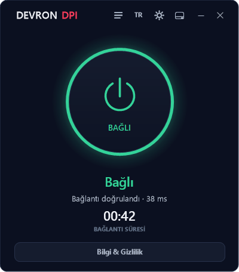
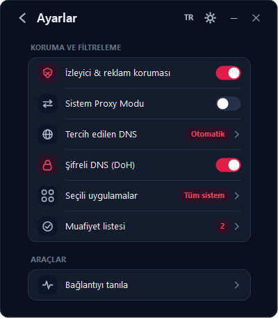
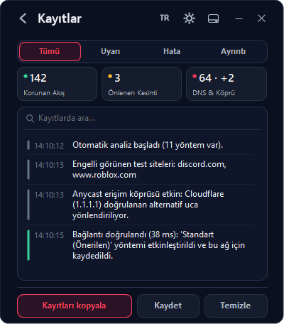
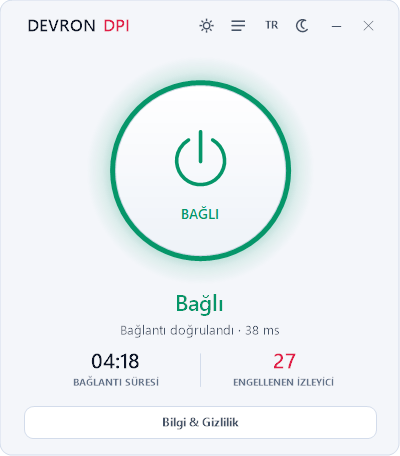
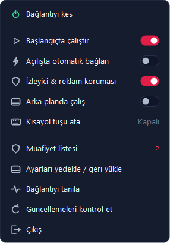
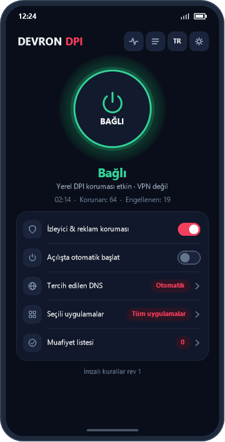
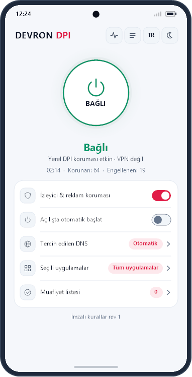

# DevronDPI

**Windows ve Android için tek tıkla DPI aşma aracı.** İnternet servis sağlayıcınızın derin paket denetimiyle (DPI) engellediği web sitelerine, uygulamalara, çevrim içi oyunlara ve sesli sohbet platformlarına VPN kullanmadan, hız ve gecikme (ping) kaybı olmadan erişin.

🇬🇧 [English](README.md) &nbsp;|&nbsp; 🇹🇷 **Türkçe** &nbsp;·&nbsp; 💻 [Windows](#windows-devrondpiexe) &nbsp;|&nbsp; 📱 [Android](#android-devrondpiapk)

     

**[⬇ Son sürümü indir (Windows `.exe` ve Android `.apk`)](../../releases/latest)**

---

## Windows (`DevronDPI.exe`)

Kurulum gerektirmez — `DevronDPI.exe` dosyasını çalıştırın ve **BAĞLAN** düğmesine basın. **Windows 10/11 x64** ve **Windows ARM64** üzerinde çalışır.

| Bağlı | Uygulama İçi Ayarlar |
|:---:|:---:|
|  |  |
| **Kayıtlar ve Canlı Sayaçlar** | **Açık Tema** |
|  |  |

### Öne çıkan özellikler (Windows)

- **Ayar istemez, ağları hatırlar.** Ağınızı test eder, çalışan yöntemi bulur ve her ağ için ayrı kaydeder (ev ağı, mobil erişim noktası vb.). Sonraki bağlantılar daha hızlı kurulur.
- **VPN değildir.** Trafik başka bir sunucudan geçmez; gecikme süresi (ping) ve hız değişmez.
- **"Bağlı" gerçekten bağlı demektir.** Engelli test siteleriyle güvenli bağlantı doğrulanmadan yeşil yanmaz.
- **Uygulama içi Ayarlar ve sadeleştirilmiş bildirim alanı menüsü.** Tüm tercihler ana penceredeki **Ayarlar** ekranı ve kayan alt sayfalarda toplanır; bildirim alanı menüsü 5 temel eylemle sadeleşir.
- **Şifreli DNS (DoH) ve Tercih Edilen DNS.** **Otomatik, Yandex, OpenDNS, AdGuard, Quad9 veya Cloudflare** seçebilir, isteğe bağlı **Şifreli DNS (DoH)** ile sistem DNS sorgularını HTTPS üzerinden şifreli iletebilirsiniz (otomatik yedekleme ve yerel ağ/Captive Portal muafiyetiyle).
- **Anycast erişim köprüsü.** Doğrudan engelli sağlayıcı IP adreslerini (`1.1.1.1`, `9.9.9.9` vb.) aynı sağlayıcıya ait sertifika doğrulamalı alternatif Anycast IP adresine yönlendirir.
- **Sürücüsüz Sistem Proxy Modu (ARM64 ve yönetici izinsiz PC'ler).** WinDivert sürücüsü ve yönetici izni gerekmeden yerel loopback proxy üzerinden çalışır (Windows ARM64 cihazlarda otomatik etkinleşir).
- **Görsel Seçili Uygulamalar.** **Ayarlar → Seçili uygulamalar** ekranında açık programları simgeleri ve anlık aramayla işaretleyip yalnızca istediğiniz uygulamaları koruyabilir veya listeyi temizleyerek tüm sistemi koruyabilirsiniz.
- **4 aşamalı Engel Röntgeni ve 8 sitelik Hızlı Test.** `1. DNS → 2. TCP → 3. TLS SNI → 4. 24 KB Akış` canlı süreleri, paralel **8 sitelik Hızlı Test** ve doğrulanan **Çalışan Kuralı Uygula** / **Muafiyet Listesine Ekle** aksiyonları.
- **Oyun, anti-cheat, kamu ve özel muafiyet listesi.** `.gov`, `.edu` ve oyun/anti-cheat servislerini (`Riot/Vanguard`, `Steam`, `Battle.net`, `EasyAntiCheat`, `BattlEye`) otomatik doğrudan geçirir; **Ayarlar → Muafiyet listesi** üzerinden kendi alan adlarınızı ekleyebilirsiniz.
- **İzleyici & reklam koruması (isteğe bağlı, 0 ms).** Bilinen reklam, izleme ve telemetri alan adlarını HTTPS şifresini kırmadan ve sertifika kurmadan yerel olarak engeller; ana ekranda canlı sayaç gösterir.
- **Discord sesli sohbet ve otomatik toparlanma.** "RTC Bağlanıyor" takılmasını önlemeye yardımcı olur; Wi-Fi değişimi, uyku ve kilit ekranı dönüşünde bağlantıyı otomatik doğrular.
- **5 dil, canlı tema takibi ve taşınabilir USB kipi.** İngilizce (varsayılan), Türkçe, Rusça, Farsça (RTL) ve İspanyolca desteği, canlı Windows Koyu/Açık tema takibi, tek tıkla ayar yedekleme/geri yükleme, `portable.flag` USB kipi ve RSA-2048 imzalı kural güncellemeleri (`rules.json`).

<b>Windows kullanımı, bildirim alanı menüsü ve yönetici izni</b>

1. `DevronDPI.exe` dosyasını çalıştırın ve **BAĞLAN** düğmesine basın. Sürücülü modda ilk bağlantıda Windows yönetici izni (UAC) ister — **Evet** diyerek onaylayın (yönetici izni olmadan kullanmak için Ayarlardan **Sistem Proxy Modu**'nu açabilirsiniz).
2. Analiz birkaç saniye sürer; bağlanırken düğmeye tekrar basarak iptal edebilirsiniz.
3. **Arka planda çalış** açıkken kapatma ve küçültme pencereyi bildirim alanına gizler; bağlantı koparsa veya toparlanırsa Windows bildirimi alırsınız.
4. **Başlangıçta çalıştır** seçeneği yönetici iznini bir kez alır, dosyayı `C:\Program Files\DevronDPI\` içine kopyalar ve zamanlanmış görev oluşturur; kapatıldığında ikisi de temizlenir.

---

## Android (`DevronDPI.apk`)

**Android 10+** cihazlar için bağımsız, **root gerektirmeyen** Material 3 uygulaması (`3.5 MB` imzalı APK · VirusTotal **0/67**). Android'in yerel cihaz içi `VpnService` arayüzünü kullanır — **harici VPN değildir**, uzak sunucuya bağlanmaz, hız ve ping kaybı yaşatmaz.

| Koyu Tema (Bağlı) | Açık Tema (Bağlı) |
|:---:|:---:|
|  |  |

### Öne çıkan özellikler (Android)

- **Root'suz cihaz içi DPI koruması.** TLS `ClientHello` kayıtlarını ve TCP parçalarını cihaz içinde böler, QUIC (UDP 443) trafiğini düşürerek tarayıcı ve Discord'un TCP TLS kullanmasını sağlar ve çift yığınlı 4G/5G ağlarda IPv6 DPI sızıntısını engeller.
- **Uygulama bazlı koruma.** Simgeleri ve arama kutusuyla yalnızca istediğiniz uygulamaları seçebilir veya tüm uygulamaları koruyabilirsiniz.
- **Tercih edilen DNS ve hızlı önbellek.** Standart dışı port yedeği ve anlık yerel yanıt önbelleğiyle **Otomatik, Yandex, OpenDNS, AdGuard, Quad9 veya Cloudflare** seçin.
- **İzleyici & reklam koruması.** Tek anahtarla 0 ms yerel reklam/izleyici engeli ve ana ekranda canlı korunan/engellenen sayaçları.
- **4 aşamalı Bağlantı Röntgeni ve paralel 8 sitelik test.** Üst çubuktaki nabız simgesinden istediğiniz siteyi test edin veya paralel 8 sitelik toplu test çalıştırıp raporu tek dokunuşla kopyalayın.
- **Hızlı Ayarlar kutucuğu ve açılışta başlatma.** Bildirim panelinden tek dokunuşla açıp kapatın veya telefon açıldığında otomatik başlatın.
- **5 dil, Koyu/Açık/Sistem teması ve imzalı kurallar.** İngilizce, Türkçe, Rusça, Farsça (RTL) ve İspanyolca, Material 3 temalar, canlı kayıt ekranı ve ortak RSA-2048 imzalı `rules.json` güncellemeleri.

### Android kurulumu

1. Android 10 veya üzeri cihazınızda [son sürümler](../../releases/latest) sayfasından `DevronDPI.apk` dosyasını indirin.
2. APK dosyasını kurun (Android sorarsa bilinmeyen uygulamalara izin verin).
3. **DevronDPI** uygulamasını açıp **BAĞLAN** düğmesine dokunun ve yerel VPN iznini bir kez onaylayın. İsterseniz bildirim paneline **DevronDPI** Hızlı Ayarlar kutucuğunu ekleyebilirsiniz.

---

## Bilmeniz gerekenler

- **Genel IP engelini aşamaz.** Bir site doğrudan IP adresi düzeyinde engelliyse (desteklenen Anycast sağlayıcıları dışında) hiçbir DPI aracı bu engeli aşamaz, VPN gerekir. DevronDPI bu durumu tespit eder ve açıklar.
- **"Bağlı" durumu her sitenin açılacağı anlamına gelmez;** ağınızda engelli görünen test sitelerine erişilebildiğini gösterir.
- **Şifreli DNS (DoH) isteğe bağlıdır.** Windows Ayarları'ndan **Şifreli DNS (DoH)** açıldığında sistem DNS sorguları HTTPS üzerinden şifreli gider; kapalıyken seçtiğiniz DNS sunucusuna UDP olarak iletilir (yerel ağ adresleri DoH'tan otomatik muaf tutulur).
- **Şirket ve okul ağlarında** DNS yönlendirmesi nedeniyle yerel ağdaki iç alan adları çözülemeyebilir.
- **QUIC engeli** nedeniyle UDP 443 portunu kullanan bazı VPN uygulamaları etkilenebilir.
- **Android VPN yuvası:** Android aynı anda tek bir `VpnService` çalıştırmaya izin verdiğinden Android'de başka bir VPN uygulamasıyla eş zamanlı çalışamaz.

## Gizlilik

- Veri toplanmaz, telemetri bulunmaz. Windows'ta ayarlar ve kayıtlar (`devron.conf`, `devron.log`, `devron-engine.log`, `rules.cache.json`) yalnızca `%AppData%\DevronDPI` (veya taşınabilir kipte uygulama klasörü) içinde, Android'de ise uygulamanın özel depolama alanında tutulur.
- Bağlantı ve tanılama kontrollerinde test edilen adreslerle yalnızca TLS bağlantı kurulumu ve kısa veri akışı doğrulaması yapılır; kişisel bir veri gönderilmez. Bağlanılan her sitede olduğu gibi karşı sunucu IP adresinizi görür.
- Üçüncü taraflara yalnızca iki bilgi gider: **DNS sorguları** seçtiğiniz sağlayıcıya (Yandex, OpenDNS, AdGuard, Quad9 veya Cloudflare), **güncelleme ve imzalı kural kontrolleri** ise GitHub sunucularına. Bu hizmetlerin kendi gizlilik politikaları geçerlidir.

## Güvenlik

- **Güncellemeler** GitHub üzerinden alınır, onayınız olmadan kurulmaz ve SHA-256 özeti eşleşmezse reddedilir. Sürüm geçmişi için [CHANGELOG.md](CHANGELOG.md) dosyasına bakabilirsiniz.
- **İmzalı kural güncellemeleri (`rules.json`)** hem Windows hem Android'de gömülü RSA-2048 açık anahtarıyla doğrulanır; imzasız, kurcalanmış veya sınır dışı hiçbir kural kabul edilmez ve kod/komut çalıştırılamaz.
- **Windows uygulaması henüz dijital imzalı değildir.** Bu nedenle Windows SmartScreen ya da "Yayıncı bilinmiyor" uyarısı görünebilir. Uygulamayı yalnızca [sürümler](../../releases) sayfasından indirin ve SHA-256 özetini sürüm notlarıyla karşılaştırın.
- **Antivirüs uyarıları** (`RiskTool.WinDivert` vb.), paket yakalama sürücüsünden (WinDivert) kaynaklanan yanlış alarmlardır. WinDivert, GoodbyeDPI uygulamasının da kullandığı Microsoft imzalı resmî bir sürücüdür. Gerekirse `DevronDPI.exe` dosyasını antivirüs istisnalarına ekleyebilirsiniz.

Güvenlik açığı bildirmek için [SECURITY.md](SECURITY.md) dosyasını inceleyin.

<b>Nasıl çalışır?</b>

DPI sistemleri bağlandığınız siteyi genellikle TLS `ClientHello` paketindeki SNI alanından tanır. DevronDPI, giden ilk bağlantı paketlerini doğrudan kendi cihazınızda yeniden düzenler:

- **SNI bölme:** `ClientHello` paketi ayrı parçalara bölünür; böylece DPI sistemi alan adını tek parça hâlinde göremez.
- **Otomatik TTL ve akıllı koruma:** Windows sürücülü modda sunucunun `SYN-ACK` yanıtından ölçülen ağ mesafesine göre iletim parametreleri otomatik ayarlanır.
- **DNS yönlendirme ve Şifreli DNS (DoH):** UDP 53 sorguları standart dışı portlu temiz DNS sunucularına (Yandex :1253, OpenDNS :5353, AdGuard :5353) iletilir veya Windows'ta **Şifreli DNS (DoH)** açıkken HTTPS üzerinden şifrelenir.
- **Anycast köprüsü:** `1.1.1.1`, `9.9.9.9`, `208.67.222.222`, `8.8.8.8` veya `94.140.14.14` doğrudan engelliyse bağlantı, işletim sisteminin sertifika deposuyla doğrulanan alternatif Anycast IP adresine yönlendirilir.
- **QUIC engeli:** Giden UDP 443 paketleri düşürülür; böylece tarayıcılar ve Discord HTTP/3 yerine TCP üzerinden TLS kullanır.
- **Android cihaz içi tünel:** Android'in yerel `VpnService` arayüzü, `hevtunnel` (`hev-socks5-tunnel`) ve cihaz içi DPI proxy motoru ile harici sunucu ve root gerekmeden çalışır.

Windows sürücülü modda 443 numaralı portta yalnızca ilk bağlantı paketleri kullanıcı moduna alınır. İndirme, video ve oyun trafiği işletim sistemi çekirdeğinde kalır; işlemci kullanımı sıfıra yakındır.

## Sıkça sorulan sorular

<b>"Bağlı" yazıyor ama bir site açılmıyor.</b>

**Ayarlar → Bağlantıyı tanıla** ekranını (Android'de üstteki nabız simgesini) açıp o sitenin adresini yazın; 4 aşamalı Engel Röntgeni sorunun tam kaynağını gösterir. Windows'ta alternatif yöntem veya muafiyet işe yarıyorsa doğrulanıp tek tıkla uygulanabilir. Doğrudan IP engellerinde VPN gerekir.

<b>Discord "RTC Bağlanıyor" aşamasında takılı kalıyor.</b>

DevronDPI bağlıyken bu sorun genellikle düzelir. Ses sunucusunun IP adresi doğrudan engelliyse açılamaz. Bağlı olduğunuzdan ve **Kayıtlar** ekranında hata bulunmadığından emin olun.

<b>Şifreli DNS (DoH) "Otomatik" DNS ile nasıl çalışır?</b>

**Tercih edilen DNS** ayarı **Otomatik** iken **Şifreli DNS (DoH)** açıldığında DevronDPI çalışan bir DoH sağlayıcısını otomatik seçer, biri yanıt vermezse diğerine kesintisiz geçer; yerel ağ ve Captive Portal adreslerini ise otomatik muaf tutar.

<b>Uygulamayı nasıl kaldırırım?</b>

Windows'ta önce Ayarlardan **Başlangıçta çalıştır** seçeneğini kapatın (zamanlanmış görevi ve `Program Files` kopyasını siler), ardından `DevronDPI.exe` dosyasını silin. İsterseniz `%AppData%\DevronDPI` ile `C:\ProgramData\DevronDPI` klasörlerini de silebilirsiniz. Android'de uygulamayı normal şekilde kaldırabilirsiniz.

## Sorun bildirme

[Sorunlar (Issues)](../../issues) sayfasından yeni kayıt açıp şunları ekleyin:

- **Kayıtlar** ekranındaki **Kayıtları kopyala** çıktısı (uygulama sürümü, yöntem özeti, sayaçlar ve motor kayıtları içindedir).
- Platformunuz (Windows veya Android), ne yaptığınız ve neyle karşılaştığınız, mümkünse ekran görüntüsü.

Kayıtlarda test edilen sitelerin adları yer alabilir; paylaşmadan önce gözden geçirin.

## Lisans

Ücretsiz ve kapalı kaynaklıdır; [LICENSE](LICENSE) koşullarıyla dağıtılır. © 2026 RRaynorr

Windows sürümü WinDivert (LGPLv3), Android sürümü `hevtunnel` / `hev-socks5-tunnel` (Apache-2.0 / MIT / BSD-3-Clause) kullanır. Ayrıntılar için [THIRD-PARTY-NOTICES.md](THIRD-PARTY-NOTICES.md) dosyasına bakın.
